# 001 X Poster Bot (@Zer0_Infra)

> AWS公式の日本語RSSからインフラ系サービスのアップデートを抽出し、Bedrock Claude で @Zer0_Infra の口調に変換して、インフラ運用者の目線でXへ毎週月・木20時に自動投稿するサーバーレスBot。3段階の重複フィルタと事実検証で品質を担保。

[](https://aws.amazon.com)
[](https://python.org)
[](https://aws.amazon.com/pricing)

## 概要

| 項目       | 内容                                                                    |
| ---------- | ----------------------------------------------------------------------- |
| 投稿頻度   | 毎週月・木 20:00 JST（夜）の週2回                                       |
| 情報ソース | AWS公式ニュース / AWSブログ日本語版（インフラ系サービスの記事のみ）     |
| 取得期間   | 過去14日以内の記事のみ                                                  |
| 重複排除   | URL完全一致 → キーワード → AWSサービス名の3段階                         |
| AI変換     | Amazon Bedrock Claude Haiku（①口調変換 → ②記事本文との事実検証の2段階） |
| IaC        | CloudFormation（全リソース管理）                                        |
| 月額コスト | ~$0.45（約70円）                                                        |

## アーキテクチャ



```text
EventBridge ルール（月・木 20:00 JST）
  └─▶ Lambda（Python 3.14）
        ├─ RSS 取得（AWS公式ニュース・AWSブログ日本語版）
        ├─ インフラ系記事の抽出 + 14日フィルタ + 3段階重複排除
        ├─ 根拠本文の取得（公式ニュースはRSS本文、ブログは<article>内）
        ├─ Bedrock Claude Haiku ①投稿文生成 → ②事実検証（2段階呼び出し）
        ├─ SSM Parameter Store（投稿履歴。4KB上限を超えないよう切り詰めて保存）
        └─ X API v2（本文投稿 → 記事URLをリプライにぶら下げ / スレッド連投）
```

## 技術スタック

| レイヤー         | 技術                                                                                 |
| ---------------- | ------------------------------------------------------------------------------------ |
| 実行基盤         | AWS Lambda（Python 3.14 / 256MB / 120秒）                                            |
| スケジューリング | Amazon EventBridge ルール（UTC cron、JST 換算）                                      |
| AI変換           | Amazon Bedrock **Claude Haiku 4.5**（`jp.anthropic.claude-haiku-4-5-20251001-v1:0`） |
| 状態管理         | AWS Systems Manager Parameter Store                                                  |
| 投稿先           | X（旧Twitter）API v2                                                                 |
| IaC              | AWS CloudFormation                                                                   |

## 実装のこだわり

### 1. インフラ系記事の抽出

AWS公式ニュースは1日に10件以上出て、生成AIや業界特化サービスの告知が大半を占める。以前は各フィードの上位5件だけを見ていたため、インフラの話題がほとんど拾われなかった。

- **全件取得してから絞り込み**: 公式ニュースは最大100件を取得し、EC2・VPC・CloudWatch・CloudFormation・ECS・Lambda等の`INFRA_KEYWORDS`をタイトルに含む記事だけを候補にする
- **部分一致の誤検出防止**: 英数字の境界つきで判定し、「WebSocket」の中の「EBS」のような一致を拾わない
- **関係の薄い告知の除外**: GovCloud・他リージョンへの提供拡大や、移行ツール等の運用と関係の薄いサービスを除外する。東京・大阪が対象に含まれる告知は残す

### 2. 3段階の重複排除ロジック

単純な URL 一致だと「別 URL の同内容記事」を投稿してしまうケースがあった。

- **第1段階**: 投稿済み URL 完全一致チェック（SSM 保存）
- **第2段階**: タイトルキーワード類似度チェック
- **第3段階**: AWS サービス名抽出 + 直近投稿との重複チェック

### 3. IAM 最小権限設計

`AmazonBedrockFullAccess` から特定モデル ARN のみ許可するカスタムポリシーに変更。SSM も `/xposter/*` パスのみ読み取り許可に絞り込み、最小権限の原則を実装。

### 4. 投稿前の事実検証（2段階 Bedrock 呼び出し）

RSS の概要150文字だけを根拠に生成すると、対応リージョン・料金・制限値などをモデルが推測で補ってしまうリスクがある。対策として、

- **グラウンディング**: 記事本文（最大2,500文字）をプロンプトに渡し、「記事に書いてあることだけを事実として使う」ルールを徹底。AWSのページは先頭がナビゲーションで占められるため、公式ニュースはRSSに入っている告知本文、ブログはページの`<article>`内だけを使う
- **体験談の禁止**: 投稿者がまだ試していない機能について「使ってみた」「ハマった」と書かないよう、生成・検証の両方で体験談の記述を禁止
- **事実検証パス**: 生成された投稿を記事本文と突き合わせる2回目の Bedrock 呼び出しで検証。根拠のない事実主張は削除または感想・疑問形に書き換えてから投稿（出力はプリフィル + JSON 形式で本文のみを確実に抽出）

### 5. リーチ最適化（万垢運用の定石を反映）

- **URLはリプライにぶら下げ**: Xのアルゴリズムは外部リンク入り投稿のリーチを抑制するため、本文にはURLを入れず投稿直後にリプライとして付ける
- **ハッシュタグは最大1個・約35%はタグなし**: Xではタグの流入効果が薄く、毎回複数タグはBot感・スパム感のシグナルになるため
- **スレッド形式の解説投稿（thread_tips）**: 「〜のアップデート、運用目線で整理してみる🧵」のようなフック＋1ツイート1ポイントの連投
- **問いかけで締める比率を最多に**: Xが公開しているおすすめアルゴリズム（[xai-org/x-algorithm](https://github.com/xai-org/x-algorithm)）では、予測リプライ率の重み（5.0）が予測いいね率の重み（0.66）の約7倍。インフラ運用者が自分の環境を答えたくなる具体的な問いかけを40%の確率で入れる

### 6. 投稿履歴の容量管理

投稿履歴はSSM Parameter Store（Standard tier、上限4KB）に1件のJSONで保存している。2026年9月に上限に達して保存が毎回失敗し、投稿タイプが1種類に固定される不具合が起きた（保存失敗は投稿成功後のため握りつぶされ、気づきにくかった）。保存前に3,800バイト以内へ古い要素から切り詰める`fit_history()`を入れ、URL履歴等の件数も実際に必要な分まで減らした。

### 7. 人間味のランダム化

毎回同じ長さ・同じ締め方になる AI っぽさを消すため、投稿ごとに「目安文字数」と「締め方（問いかけ40%/共感25%/感想25%/余韻10%）」をコード側で抽選してプロンプトに注入。同義ハッシュタグ（`#ElasticLoadBalancing`→`#ELB`、`#SystemsManager`→`#SSM`）は略称側に正規化して重複排除。

## ディレクトリ構成

```text
001_x-poster_zer0-infra/
├── src/
│   ├── lambda_function.py          # メインロジック
│   ├── cfn-x-poster-zer0-infra.yaml
│   ├── deploy.sh                   # デプロイスクリプト
│   └── requirements.txt
├── tests/                          # pytest（純関数のユニットテスト）
└── images/
    ├── 001_architecture_plugin.drawio        # 構成図（draw.ioで手動編集する一次情報源）
    └── 001_architecture_plugin_flowdot.svg   # 上記からエクスポートした画像（本ドキュメントで表示）
```

## デプロイ

```bash
# 初回（CloudFormation + Lambda コード）
bash src/deploy.sh --full

# コードのみ更新
bash src/deploy.sh

# DRY_RUN テスト（実投稿なし）
bash src/deploy.sh --test
```

## 運用コマンド

```bash
# 最新ログ確認
aws logs tail /aws/lambda/x-poster-zer0-infra --follow --region ap-northeast-1

# EventBridge 一時停止・再開
aws events disable-rule --name x-poster-zer0-infra-evening --region ap-northeast-1
aws events enable-rule  --name x-poster-zer0-infra-evening --region ap-northeast-1

# 投稿履歴リセット（重複投稿が起きた場合）
aws ssm delete-parameter --name "/xposter/posted-history" --region ap-northeast-1
```

## ロールバック

```bash
# デプロイ済みバージョン一覧確認
aws lambda list-versions-by-function --function-name x-poster-zer0-infra \
  --region ap-northeast-1 --query "Versions[-5:].[Version,LastModified]" --output table

# 前バージョンに戻す（GitHub から該当コミットを checkout → 再デプロイ）
bash src/deploy.sh
```

## コスト内訳

| サービス                                   | 月額                 |
| ------------------------------------------ | -------------------- |
| Lambda 実行（約9回/月 × ~6秒）             | ~$0                  |
| Bedrock Claude Haiku（生成+検証 2回/投稿） | ~$0.02               |
| X API（$0.02/件 × 約21件/月）              | ~$0.43               |
| EventBridge・SSM                           | ~$0                  |
| **合計**                                   | **~$0.45（約70円）** |

X APIの件数は、通常投稿が本文＋URLリプライの2件、スレッドが約3.5件で、4タイプを順に回す前提の概算。

## トラブルシューティング

| 症状           | 原因                          | 対処                                   |
| -------------- | ----------------------------- | -------------------------------------- |
| 投稿が0件      | RSS/Atom フィード取得失敗     | CloudWatch Logs で HTTP ステータス確認 |
| 重複投稿       | SSM パラメータ破損            | `/xposter/posted-history` を手動クリア |
| Bedrock エラー | IAM 権限不足                  | カスタムポリシーのモデル ARN を確認    |
| X API 403      | レート制限                    | 15分後に再実行                         |
| 投稿タイプが毎回同じ | SSM履歴の保存失敗（上限4KB超過） | ログの`[History] 保存失敗`を確認。`fit_history()`の上限・件数を見直す |
| インフラ系記事0件 | 日本語版フィードの掲載遅れ・キーワード不一致 | ログの`[RSS] インフラ系N件`を確認。`INFRA_KEYWORDS`を見直す |

## 変更履歴

直近1日分のみ表示。全履歴は [CHANGELOG.md](./CHANGELOG.md) を参照。

### 2026-10-29

#### 変更履歴の長い箇条書きを分割

- 200文字を超えていた箇条書きを「。」の区切りで複数の箇条書きに分けた（文言の変更なし、機械的に内容の一致を確認）。
